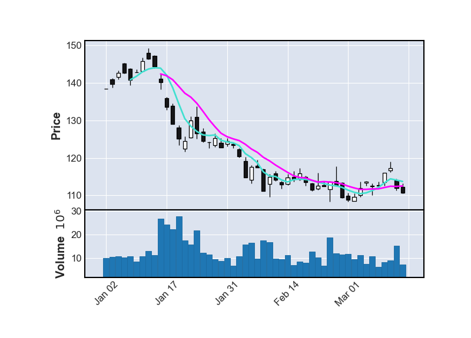

  
# Portfolio Optimization with CQM and StrideTM Hybrid Solvers

For the portfolio optimization problem, we will develop a program that produces an optimized selection of stocks. We will approach this problem using both the Constrained Quadratic Model and Stride hybrid solvers, allowing comparison between the two solvers. Additionally, when using the Stride hybrid solver, we will represent the decision variable as a binary variable and then as a set. 

In this exercise, two-year data for 10 stocks are used and their average return rates are calculated using daily closing prices. The stocks considered in this exercise are "T" (AT&T), "SFL" (FSL), "PFE" (Pfizer), "XOM" (Exxon Mobil), "MO" (Altria Group), "VZ" (Verizon Communications), "IBM" (IBM), "TSLA" (Tesla), "GILD" (Gilead Sciences), and "GE" (General Electric). In the folder `data` are CSV files with daily closing prices and monthly returns for each stock in this period of time.

Using available data, stocks can be analyzed individually. For example, the figure below shows a 50-day candlestick chart and its moving average over 5-day and 10-day windows for stock GE. However, a much more effective way to optimize a portfolio is to consider a collection of stocks and how they might balance each other out.

To effectively optimize a portfolio of stocks, we want to take into consideration:

   1. average returns,

   2. available budget,

   3. and variance between stocks.

For condition 1, use average return rates prepared in the CSV file, `monthly_returns.csv`, in order to build a model that will maximize the anticipated returns.

For condition 2, use the last day's closing price from the file, `lastday_closing_price.csv`, to ensure the available budget is not exceeded.

For condition 3, compute the covariance between pairs of stocks from the average returns information that is available. Covariance allows us to take into account how similar or different the behavior of the two stocks are. When the covariance is large, the two stocks behave in a similar manner – if one stock value drops then it's likely that the other will as well. We want to minimize the covariance in order to minimize the risk of the portfolio. The covariance is calculated in the exercise program files and provided for use.

## Exercise 1: CQM with one constraint

For the upcoming three exercises, build the portfolio optimiation problem using the CQM hybrid solver. 

In exercise 1, build a basic portfolio of two stocks in order to maximize returns.

Open the code file `exercise_1_cqm_1_constraint.py`.

   1. Define a binary variable named `s_stk` for each stock 'stk', and store the variables in a list called `stocks`, which will be returned by the `define_variables` function.

   2. In the `build_cqm` function:
   
      - Initialize the CQM object called `cqm`, and import any necessary packages.

      - Add a constraint to the CQM to choose exactly two stocks. Use the label 'choose k stocks'.

      - Set an objective function in the CQM to maximize returns.

   3. In the `sample_cqm` function:

      - Define the sampler to be used. Remember to import any necessary packages.

      - Sample the CQM object by submitting the cqm model to the sampler. 

## Exercise 2: CQM with two constraints

For exercise 2, start with the CQM built in exercise 1, and add a constraint for the available budget.

Open the code file `exercise_2_cqm_2_constraints.py`.

   1. Repeat steps 1 to 3 of exercise 1.

   2. In the `build_cqm` function, add a constraint to the CQM that the cost of the purchased stock should not exceed the budget. Use the label 'budget_limitation'.

## Exercise 3: CQM with quadratic objective

For exercise 3, start with the CQM built in exercise 2, then add an additional objective to minimize variance.

Open the code file `exercise_3_cqm_quadratic_objective.py`.

   1. Repeat steps 1 to 2 of exercise 2.

   2. In the `build_cqm` function, add "minimize variance" to the objective. Some hints:

      - Determine each objective separately then add them together.

      - Variance is computed as a quadratic term: `variance[i][j]*stocks[i]*stocks[j]` for **distinct** pairs (i, j).
      
      - Note: In Markowitz's modern portfolio theory, typically variance-covariance Matrix sums up linear and quadratic terms with summations to start at 1 for both i and j. However, for this particular practice problem, **try to only look at distinct pairs of sums**. This modification means we examine only the effect between pairs of different stocks in this practice problem.

## Exercise 4: Stride with binary variable and one constraint then test initial state

For the next three exercises, build the same portfolio optimiation problem, but this time use the Stride hybrid solver. First, model the problem using a binary variable to represent  the decision variable. Test an initial state to explore the code, then submit it to the Stride hybrid solver.

In exercise 4, build a basic portfolio of two stocks in order to maximize returns. Then, test the code with an initial state. 

Open the code file `exercise_4_stri_bin_1_constraint_initial_state.py`.

   1. In the `build_model` function:
   
      - Create a nonlinear model object, called `model`, and import the required package.
      
      - Define the binary decision variable and store it in `stocks`. Use `len()` to determine the total number of binary variables.
      
      - Add the constants to the model object. 
         - Add `returns` to the model object and name it `ret`.
         - Add `num_stocks_to_buy` to the model object and name it `capacity`.
         
      - Define the objective function to maximize the total return of the portfolio.

      - Add the constraint to ensure that exactly two stocks are selected. 

   2. In main:

      - Lock the model to prevent changes. 

      - Define the number of states. In this case, only one state is being tested. 
   
      - Provide the following initial state `[0,0,0,1,1,0,0,0,0,0]`. This is a vector of 10 binary variables that is chosen randomly and satisfies the constraint. Remember to use the `set_state()` method to assign the specifcied state to its index. 

      - Return the initial state for the binary variable symbol and store it in `stocks_state`. 

      - Return the objective value of the initial state and store it in `objective_value`. 

## Exercise 5: Stride with binary variable and one constraint then submit to the solver

In exercise 5, start with the nonlinear model built in exercise 4, and then submit the problem to the Stride hybrid solver to return the optimal solution. 

Open the code file `exercise_5_stri_bin_1_constraint_submit_solver.py`.

   1. Repeat step 1 of exercise 4.

   2. In the `sample_nl` function:

      - Instantiate the nonlinear sampler and name it `sampler`. Remember to import any necessary packages.

      - Submit the nonlinear model to the nonlinear sampler. Give this problem a label on your Leap dashboard by using the `label` parameter. Use the label 'Portfolio_Stride_Binary'. Note that this label is case sensitive and uses an underscore.

   3. In main:
      
      - Lock the model to prevent changes.
      
      - Once you submit the nonlinear model to the Stride hybrid solver, return the optimal solution for the binary variable symbol, and store it in `stocks_state`. 
      
      - Return the objective value of the optimal solution and store it in `objective_value`. 

## Exercise 6: Stride with binary variable, two constraints, and quadratic objective, then submit to the solver

For exercise 6, we start with the nonlinear model built in exercise 5, add an additional objective to minimize variance, then add a constraint for the available budget.

Open up the code file `exercise_6_stri_bin_2_constraints_quadratic_objective.py`.

   1. Repeat steps 1 to 3 of exercise 5.

   2. In the `build_model` function, add "minimize variance" to the objective. Some hints:
      - Add more constants to the model object. 
         - Add `price` to the model object and name it `pri`.
         - Add `budget` to the model object and name it `bud`. 
         - Add `variance` to the model object and name it `var`.

      - Define the objective function to maximize the total return and minimize the variance of the portfolio.
      
         -  Determine each objective separately then add them together.

         - Variance is computed as a quadratic term: `var[i][j]*stocks[i]*stocks[j]` for **distinct** pairs (i, j).
      
      - Add the constraint that the cost of the purchased stock should be at most a certain budget. 

## Exercise 7: Stride with set variable and one constraint then test initial state

For the next three exercises, build the same portfolio optimiation problem as before using the Stride hybrid solver, but this time use a set as the decision variable instead of binary.

In exercise 7, build a basic portfolio of two stocks in order to maximize returns. Then, test the code with an initial state. 

Open the code file `exercise_7_stri_set_1_constraint_initial_state.py`.

   1. In the `build_model` function:
   
      - Create a nonlinear model object called `model` and import the required package.
      
      - Define the set decision variable and store it in `selected_stocks`. Use `len()` to specify the total number of elements in the set as `range(len())`. The constraint on the number of selected stocks is enforced implicitly. Ensuring that exactly two stocks are selected is enforced by the structure of the set decision variable, which restricts its size. Be sure to specify this using the `min_size` and `max_size` parameters.

      - Add the constant to the model object. 
         - Add `returns` to the model object and name it `ret`.
         
      - Define the objective function to maximize the total return of the portfolio.

   2. In main:

      - Lock the model to prevent changes. 

      - Define the number of states. In this case, only one state is being tested. 
   
      - Provide the following initial state `[3, 4]`. This set is chosen randomly and satisfies the constraint. Remember to use the `set_state()` method to assign the specifcied state to its index. 

      - Return the initial state for the set variable symbol, and store it in `stocks_state`. 

      - Return the objective value of the initial state and store it in `objective_value`. 

## Exercise 8: Stride with set variable and one constraint then submit to the solver

In exercise 8, start with the nonlinear model built in exercise 7 and then submit the problem to the Stride hybrid solver to return the optimal solution. 

Open the code file `exercise_8_stri_set_1_constraint_submit_solver.py`.

   1. Repeat step 1 of exercise 7.

   2. In the `sample_nl` function:

      - Instantiate the nonlinear sampler and name it `sampler`. Remember to import any necessary packages.

      - Submit the nonlinear model to the nonlinear sampler. Give this problem a label on your Leap dashboard by using the `label` parameter. Use the label 'Portfolio_Stride_Set'. Note that this label is case sensitive and uses an underscore.

   3. In main:
      
      - Lock the model to prevent changes.
      
      - Once you submit the nonlinear model to the Stride hybrid solver, return the optimal solution for the set variable symbol, and store it in `stocks_state`. 
      
      - Return the objective value of the optimal solution and store it in `objective_value`. 

## Exercise 9: Stride with set variable, two constraints, and quadratic objective, then submit to the solver

For exercise 9, start with the nonlinear model built in exercise 8 add an additional objective to minimize variance, then add a constraint for the available budget.

Open the code file `exercise_9_stri_set_2_constraints_quadratic_objective.py`.

   1. Repeat steps 1 to 3 of exercise 8.

   2. In the `build_model` function:
      - Add more constants to the model object. 
         - Add `price` to the model object and name it `pri`.
         - Add `budget` to the model object and name it `bud`. 
         - Add `variance` to the model object and name it `var`.

      - Define the objective function to maximize the total return and minimize the variance of the portfolio.

         - Determine each objective separately then add them together.

         - Variance is computed as a quadratic term: `var[i][j] for i, j in combinations(selected_stocks, 2)`. Remember to import any necessary packages.
      
      - Add the constraint that the cost of the purchased stock should be at most a certain budget. 
